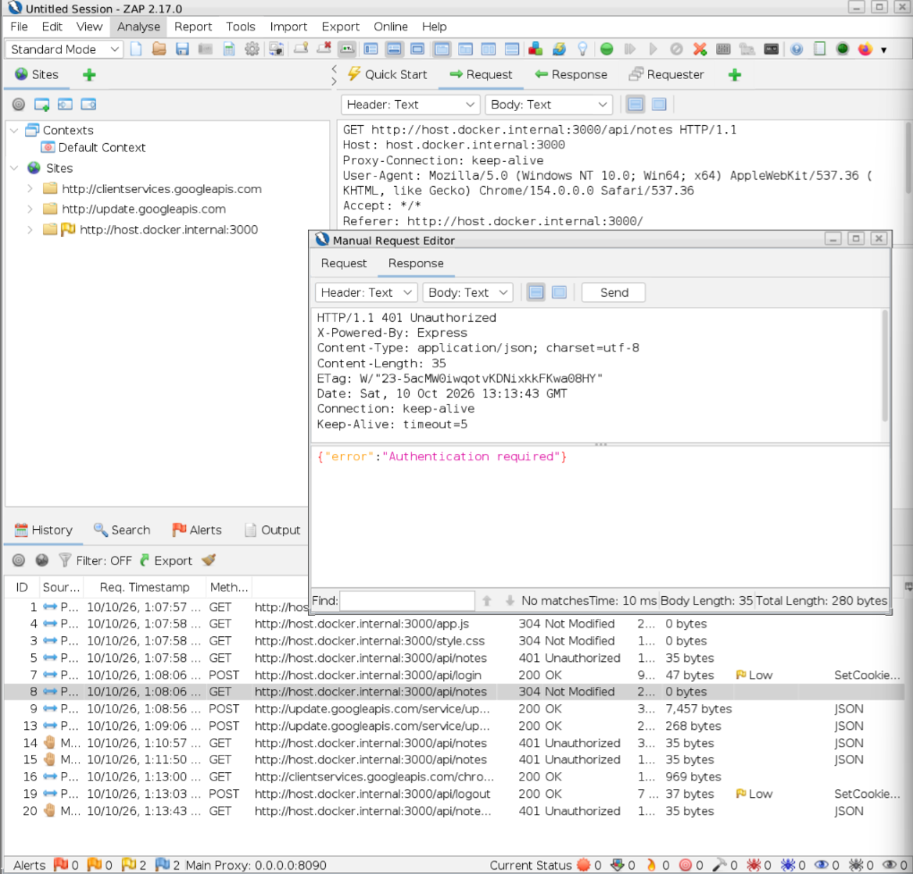
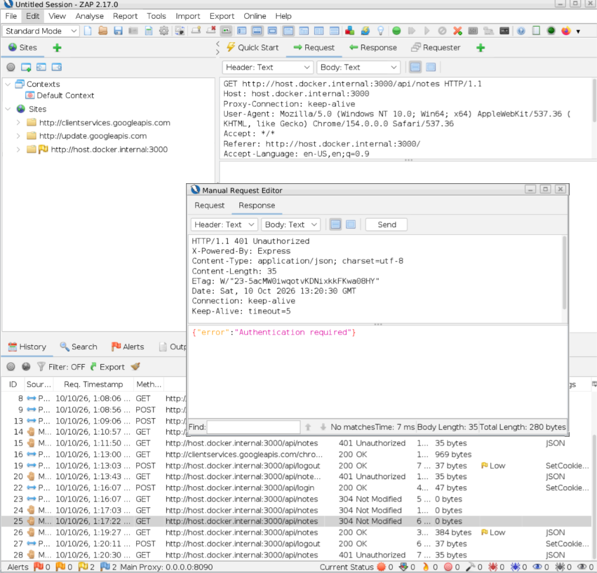
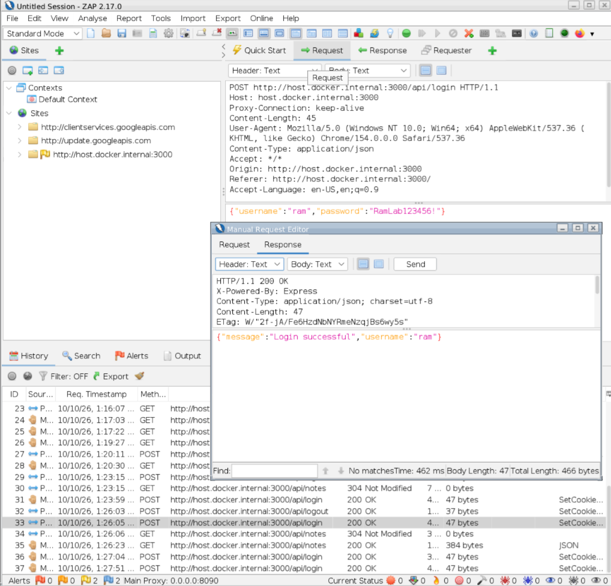
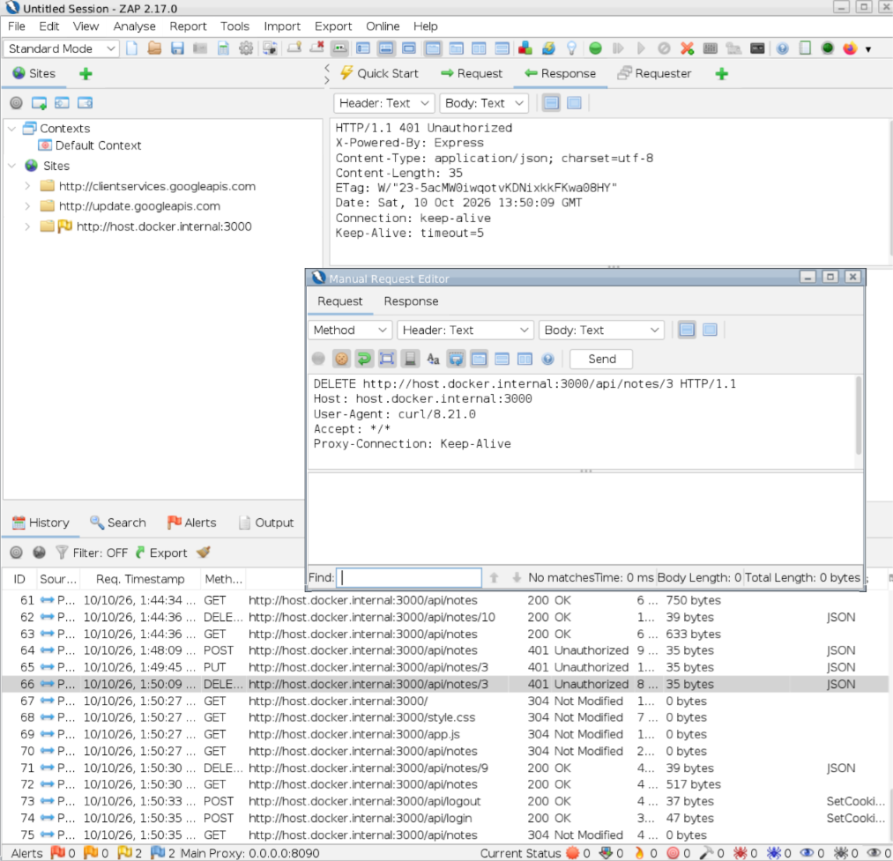

# Authentication and Session Security Assessment

## Test Information

Application: Secure Notes Lab

Testing Tools: OWASP ZAP, PowerShell, curl

Assessment Date: 10 October 2026

Environment: Local Development Laboratory

Application Port: 3000

OWASP References:
- WSTG-ATHZ-02: Testing for Bypassing Authorization Schema
- WSTG-SESS-02: Testing for Cookies Attributes
- WSTG-SESS-03: Testing for Session Fixation
- WSTG-SESS-06: Testing for Logout Functionality

## Objective

Assess whether the application correctly restricts
access to authenticated users, invalidates sessions
after logout, renews session identifiers, and
configures session cookies appropriately.

## Test 1: Unauthenticated Read Access

### Test Scenario

HTTP GET requests were sent without authentication
cookies or authorization headers.

Tested Endpoints:
- GET /api/notes
- GET /api/notes/2

### Actual Results

GET /api/notes:
HTTP 401 Unauthorized

GET /api/notes/2:
HTTP 401 Unauthorized

The application denied access to private notes
when no authenticated session was provided.

### Conclusion

PASS - TESTED ENDPOINTS

## Test 2: Logout Session Invalidation

### Test Scenario

Ram authenticated and accessed his private notes.

The session cookie was preserved in OWASP ZAP.

Ram logged out through the application.

The previously valid session cookie was then
replayed against the protected notes endpoint.

### Actual Results

Before Logout:
HTTP 200 OK

Logout Request:
HTTP 200 OK

Old Session Cookie Replayed After Logout:
HTTP 401 Unauthorized

The previously authenticated session no longer
granted access after logout.

### Conclusion

PASS

The tested session was invalidated after logout.

## Test 3: Session Regeneration

### Test Scenario

Ram logged in again after the previous session
had been invalidated.

The old and new session cookie values were
compared locally.

### Actual Results

Session Cookie Comparison:
Different values observed.

Access Using New Session:
HTTP 200 OK

Source Code Review:

The login handler calls req.session.regenerate()
after successful credential verification.

### Conclusion

PASS - OBSERVED SESSION RENEWAL

The application issued a different session
identifier for the new login.

This supports the session regeneration control
observed in the source code.

The test does not constitute a comprehensive
session fixation assessment.

## Test 4: Session Cookie Attributes

### Test Scenario

The Set-Cookie response header was inspected
after successful authentication.

### Actual Results

HttpOnly: Present

SameSite: Strict

Secure: Absent

### Assessment

HttpOnly restricts JavaScript access to the
session cookie.

SameSite=Strict restricts cross-site cookie
transmission.

The Secure attribute is absent because this
application uses HTTP in a local development
environment.

Production deployment would require HTTPS and
Secure session cookies.

### Conclusion

PASS - LOCAL DEVELOPMENT CONFIGURATION

Production hardening is required before deployment
outside the controlled laboratory.

## Test 5: Unauthenticated Write Operations

### Test Scenario

POST, PUT, and DELETE requests were sent without
authentication cookies or authorization headers.

Testing was performed through OWASP ZAP using
PowerShell and curl.

Tested Endpoints:
- POST /api/notes
- PUT /api/notes/3
- DELETE /api/notes/3

### Actual Results

POST /api/notes:
HTTP 401 Unauthorized

PUT /api/notes/3:
HTTP 401 Unauthorized

DELETE /api/notes/3:
HTTP 401 Unauthorized

Note Integrity Verification:

Ram's original note remained present and unchanged
following the unauthorized modification and deletion
attempts.

### Testing Note

An initial POST request in ZAP created a note because
the transmitted request contained an authenticated
session cookie.

The request was retested without authentication
headers using curl through the ZAP proxy.

The corrected unauthenticated test returned
HTTP 401 Unauthorized.

Only the verified unauthenticated result is
considered in the security assessment.

### Conclusion

PASS - TESTED WRITE OPERATIONS

## Security Controls Identified

The application uses the following controls:

- Authentication middleware for protected endpoints
- Server-side session tracking
- Session regeneration after login
- Session destruction during logout
- HttpOnly session cookies
- SameSite=Strict cookie configuration
- Ownership checks for private notes

## Security Findings and Recommendations

No authentication bypass was demonstrated in
the tested scenarios.

The following hardening measures are recommended
before any production deployment:

1. Enforce HTTPS and enable Secure cookies.
2. Replace the development session store with a
   production-appropriate persistent session store.
3. Review session expiration and idle timeout behavior.
4. Evaluate CSRF protection for state-changing requests.
5. Add rate limiting to authentication endpoints.
6. Continue testing additional authentication and
   session management scenarios.

## Overall Conclusion

PASS - TESTED AUTHENTICATION AND SESSION CONTROLS

The application rejected unauthenticated read and
write operations, invalidated the tested session
after logout, and issued a different session
identifier after a subsequent login.

The local session cookie configuration matched
the expected development settings.

No authentication bypass was identified during
the performed tests.

## Limitations

Testing was conducted in a controlled local
environment using fictional accounts.

The assessment did not comprehensively test
session fixation, CSRF, brute-force protection,
session expiration, or all possible authentication
bypass techniques.

The results should not be interpreted as a
complete production security certification.
