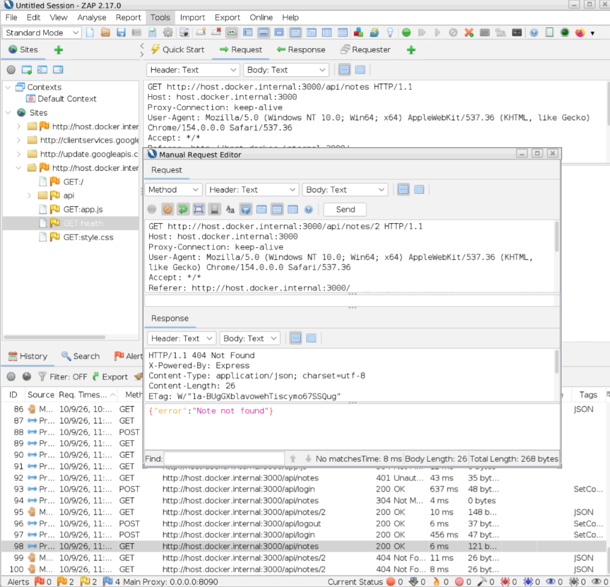
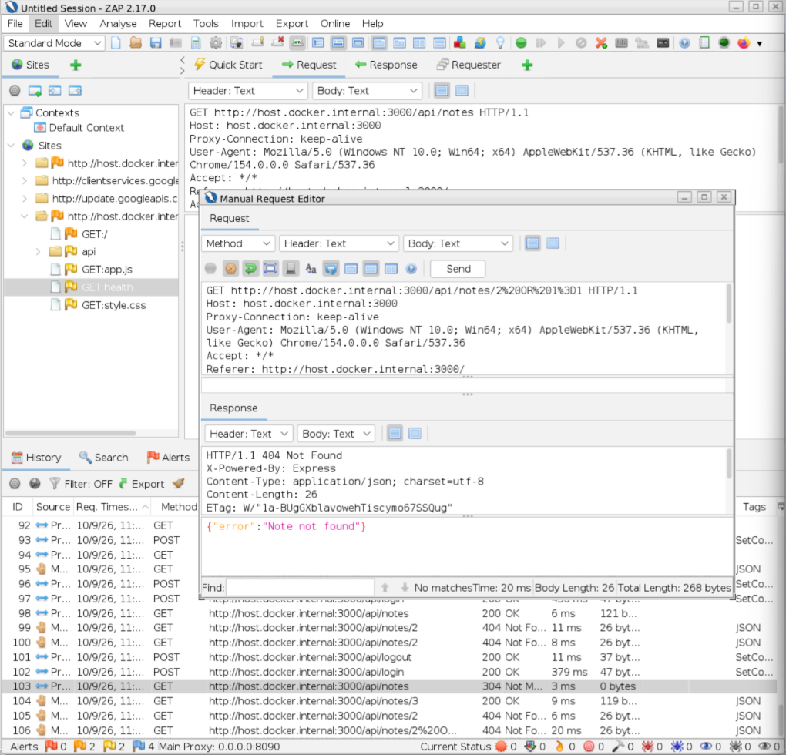
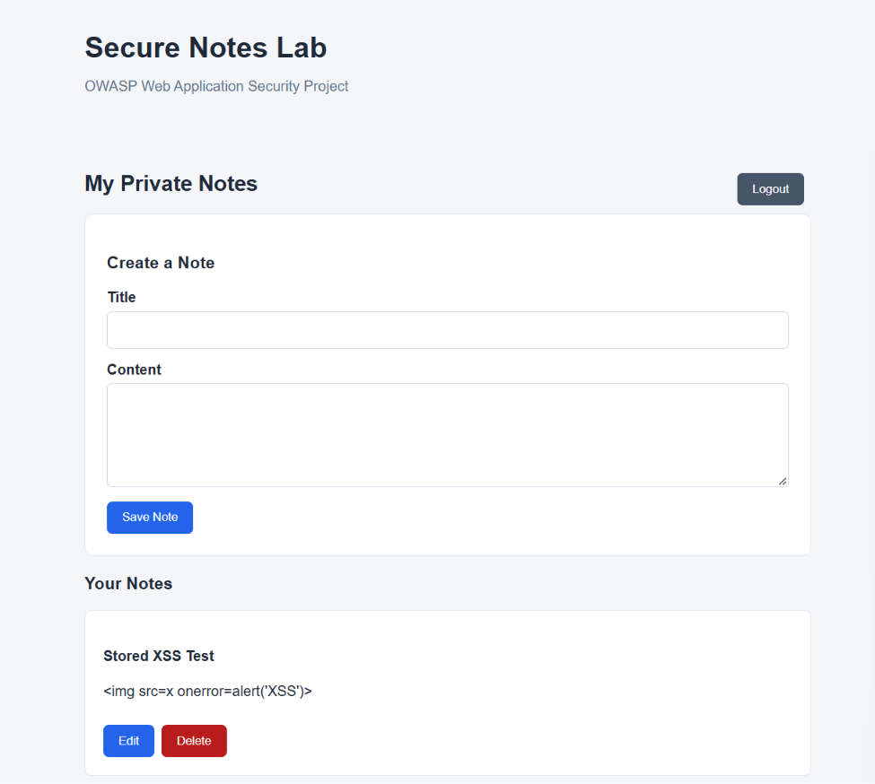
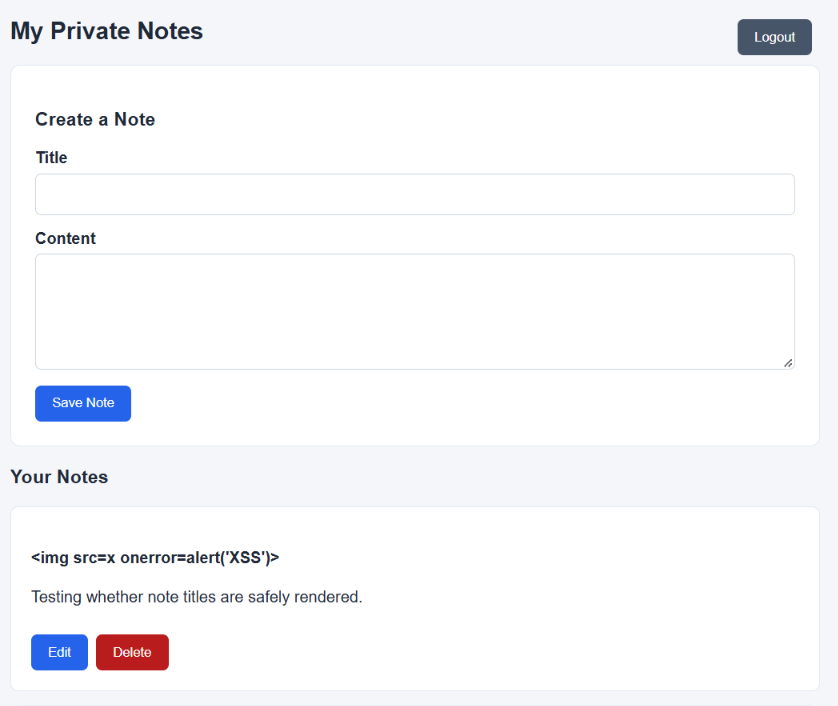
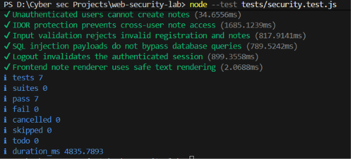

# Secure Notes Lab: Final Security Assessment

## 1. Executive Summary

Secure Notes Lab is a web application developed using
Node.js, Express, SQLite, and JavaScript.

This project evaluates selected web application security
controls using OWASP testing guidance, manual testing,
OWASP ZAP, source code review, and automated regression
tests.

The assessment focused on:

- Broken Access Control and IDOR
- SQL Injection
- Stored Cross-Site Scripting (XSS)
- Authentication and Session Management
- Input Validation
- Automated Security Regression Testing

An IDOR vulnerability was deliberately introduced into
an isolated educational version of the application.

The vulnerable version disclosed another user's private
note, while the secure implementation rejected the
same unauthorized access scenario.

No successful SQL injection, stored XSS, or authentication
bypass was identified in the tested secure application
scenarios.

Seven automated regression test groups completed
successfully with zero failures.

These results apply to the tested functionality and do
not constitute a comprehensive security certification.

## 2. Application Overview

### Technology Stack

- Backend: Node.js and Express
- Database: SQLite
- Frontend: HTML, CSS, and JavaScript
- Authentication: Express Sessions and bcryptjs
- Security Testing: OWASP ZAP
- Automation: Node.js Built-in Test Runner

### Application Functionality

The application supports user registration, login,
logout, and private note management.

Authenticated users can create, view, update, and
delete their own notes.

Each note is associated with an owner ID, which is used
by the secure implementation to enforce authorization.

### Assessment Environments

Secure Application:
- Source: src/
- Port: 3000
- Resource ownership verification enabled

Intentionally Vulnerable IDOR Lab:
- Source: lab/idor/
- Port: 3001
- GET note ownership verification deliberately removed

Both versions were used in a controlled local environment.

## 3. Assessment Methodology

The assessment combined:

1. Manual HTTP request testing using OWASP ZAP
2. Modification and replay of authenticated requests
3. Testing of unauthenticated requests
4. Input validation and injection payload testing
5. Source code review of SQL queries and frontend rendering
6. Session lifecycle and cookie attribute inspection
7. Automated security regression tests

Testing was performed using fictional user accounts
and locally stored test notes.

### OWASP Testing References

- WSTG-ATHZ-04: Testing for Insecure Direct Object References
- WSTG-INPV-05: Testing for SQL Injection
- WSTG-INPV-02: Testing for Stored Cross Site Scripting
- OWASP Web Security Testing Guide: Session Management Testing

## 4. Security Assessment Results

### 4.1 Broken Access Control: IDOR

#### Objective

Verify that an authenticated user cannot retrieve,
modify, or delete another user's private notes.

#### Secure Implementation

The secure application uses ownership restrictions:

    WHERE id = ? AND owner_id = ?

Ram attempted to access private notes belonging to Riya.

Observed results:

- Unauthorized GET: HTTP 404 Not Found
- Unauthorized PUT: HTTP 404 Not Found
- Unauthorized DELETE: HTTP 404 Not Found

Riya's note remained unchanged following the tested
unauthorized modification and deletion attempts.

#### Intentionally Vulnerable Implementation

An isolated application version was created with the
ownership check removed from its GET note query.

Vulnerable condition:

    WHERE id = ?

Using Ram's authenticated session, an HTTP GET request
targeting Riya's note returned:

    HTTP 200 OK

The response disclosed Riya's private note title
and content.

#### Comparison

| Scenario | Secure Version | Vulnerable Version |
|---|---|---|
| Unauthorized GET | 404 Not Found | 200 OK |
| Private note disclosed | No | Yes |
| Ownership verification | Enabled | Missing |

#### Security Impact

If deployed in a real multiuser application, the
vulnerable GET implementation could expose private
notes to authenticated users who do not own them.

Risk Rating: High for the deliberately vulnerable
implementation if exposed to untrusted users.

This vulnerability was intentionally introduced into
the isolated laboratory. It was not discovered in
the original secure application.

#### Secure Alternative

The secure implementation binds both the requested
note ID and authenticated user ID to the SQL query.

This prevents the demonstrated unauthorized
retrieval scenario.

#### Evidence

Detailed Reports:
- [GET baseline](idor-baseline.md)
- [PUT authorization test](idor-put-test.md)
- [DELETE authorization test](idor-delete-test.md)
- [Vulnerability demonstration](idor-vulnerability.md)
- [Secure and vulnerable comparison](idor-comparison.md)

### 4.2 SQL Injection Assessment

#### Objective

Determine whether user-controlled input can alter SQL
query logic or expose unauthorized database records.

#### Testing Performed

The following payloads were tested in the note ID:

    2 OR 1=1

    2'

Both requests returned:

    HTTP 404 Not Found

No private note disclosure was observed.

#### Source Code Review

Database operations in src/server.js and
src/database.js were reviewed.

Application queries consistently used prepared
statements with bound parameters.

Example:

    SELECT id, title, content, created_at
    FROM notes
    WHERE id = ? AND owner_id = ?

No direct interpolation of user-controlled values
into SQL statements was identified in the reviewed code.

#### Conclusion

PASS - TESTED SQL INJECTION SCENARIOS

The tested payloads did not produce unauthorized
data disclosure.

The source review supports the use of parameterized
queries as a primary SQL injection prevention control.

This does not establish protection against every SQL
injection technique or future implementation change.

#### Evidence

Detailed Report:
[SQL Injection Baseline Assessment](sqli-baseline.md)

### 4.3 Cross-Site Scripting Assessment

#### Objective

Determine whether note titles or content can execute
attacker-controlled JavaScript when displayed
in the application.

#### Test Payload

    

The payload was tested in:

- Note content
- Note title

#### Observed Results

No JavaScript alert was observed during either test.

The note title payload appeared as plain text.

#### Frontend Code Review

The frontend uses textContent for displaying
note titles and content.

Relevant implementation:

    title.textContent = note.title;
    content.textContent = note.content;

No executable innerHTML assignments or document.write()
calls were identified in the reviewed frontend file.

#### Conclusion

PASS - TESTED STORED XSS SCENARIOS

The tested payload did not execute JavaScript.

The reviewed rendering approach treats note content
as text rather than executable HTML.

The assessment does not cover all XSS contexts
or possible payload variations.

#### Evidence

Detailed Report:
[XSS Security Assessment](xss-assessment.md)

### 4.4 Authentication and Session Security

#### Unauthenticated Read Access

Requests without authentication cookies were sent to:

- GET /api/notes
- GET /api/notes/2

Both requests returned:

    HTTP 401 Unauthorized

#### Logout Session Invalidation

An authenticated session successfully accessed
private notes before logout.

After logout, replaying the old session cookie
returned:

    HTTP 401 Unauthorized

#### Session Renewal

A new login produced a session cookie different
from the previous cookie.

The new session successfully accessed the user's notes.

The source code also calls req.session.regenerate()
after successful authentication.

#### Cookie Security

Observed session cookie attributes:

- HttpOnly: Present
- SameSite: Strict
- Secure: Absent

The Secure attribute is absent in the local HTTP
development environment.

HTTPS and Secure cookies are required as part of
production deployment hardening.

#### Unauthenticated Write Access

Unauthenticated requests were sent to:

- POST /api/notes
- PUT /api/notes/3
- DELETE /api/notes/3

All returned:

    HTTP 401 Unauthorized

The targeted note remained present and unchanged.

An initial ZAP POST request had included an
authenticated cookie and created a note.

The request was subsequently retested without
authentication using curl through ZAP.

The correctly unauthenticated request returned 401.

#### Conclusion

PASS - TESTED AUTHENTICATION AND SESSION CONTROLS

The tested protected endpoints rejected unauthenticated
requests, and the previously valid session was rejected
after logout.

These results do not represent a comprehensive assessment
of session fixation, CSRF, or authentication abuse.

#### Evidence

Detailed Report:
[Authentication and Session Assessment](auth-session-assessment.md)

## 5. Automated Security Regression Testing

Security regression tests were implemented using
the Node.js built-in test runner.

The application was configured to use an isolated
temporary database for automated testing.

### Test Coverage

| Test Group | Result |
|---|---|
| Unauthenticated note listing | PASS |
| Unauthenticated note creation | PASS |
| Cross-user IDOR protection | PASS |
| Registration and note input validation | PASS |
| SQL injection test payloads | PASS |
| Logout session invalidation | PASS |
| Frontend safe text rendering check | PASS |

### Final Test Results

    Tests: 7
    Passed: 7
    Failed: 0

The frontend rendering check is a source-code
regression test, not a browser-based XSS execution test.

The automated tests run against the secure application,
not the intentionally vulnerable IDOR lab.

## 6. Risk Assessment and Recommendations

### Confirmed Laboratory Vulnerability

IDOR in the intentionally vulnerable GET endpoint.

Potential Impact:
Unauthorized disclosure of private note information.

Risk Rating:
High if this vulnerable implementation were deployed
to an environment accessible by untrusted users.

Status:
Demonstrated in an isolated educational lab.

Secure Alternative:
Resource ownership verification demonstrated
in the secure application.

### Production Hardening Recommendations

The following improvements are recommended before
considering deployment outside the local laboratory:

1. Enforce HTTPS and enable Secure session cookies.
2. Replace the development-only session store.
3. Introduce authentication rate limiting.
4. Evaluate CSRF protection for state-changing requests.
5. Validate note IDs as positive integers.
6. Review session expiration and timeout policies.
7. Add relevant HTTP security headers.
8. Expand automated tests and input coverage.

These recommendations are not all confirmed exploitable
vulnerabilities. They identify security controls
that warrant further implementation or assessment.

## 7. Assessment Limitations

The assessment was performed in a local educational
environment using fictional accounts and test data.

The testing was focused on selected OWASP-related risks.

It did not comprehensively evaluate:

- All OWASP Top 10 risk categories
- Every possible injection or XSS payload
- CSRF exploitation
- Password guessing and brute-force resistance
- Network infrastructure security
- Third-party dependency vulnerabilities
- Production deployment and HTTPS configuration
- Full session fixation resistance
- Security under high traffic or concurrent load

Seven passing automated tests indicate that the
implemented checks passed, not that the entire
application is free from vulnerabilities.

## 8. Final Conclusion

Secure Notes Lab demonstrated the application of
multiple web application security controls through
manual testing, source review, and automation.

The isolated IDOR experiment illustrated how removing
resource ownership verification can expose private data.

The secure implementation successfully rejected the
tested unauthorized access scenarios.

The tested SQL injection and stored XSS payloads
did not produce successful exploitation.

Authentication and session testing confirmed the
expected behavior for the assessed scenarios.

All seven automated regression test groups passed.

The project provides a reproducible educational
demonstration of selected web application security
testing and defensive development practices.

Further security hardening and testing would be
required before production deployment.
