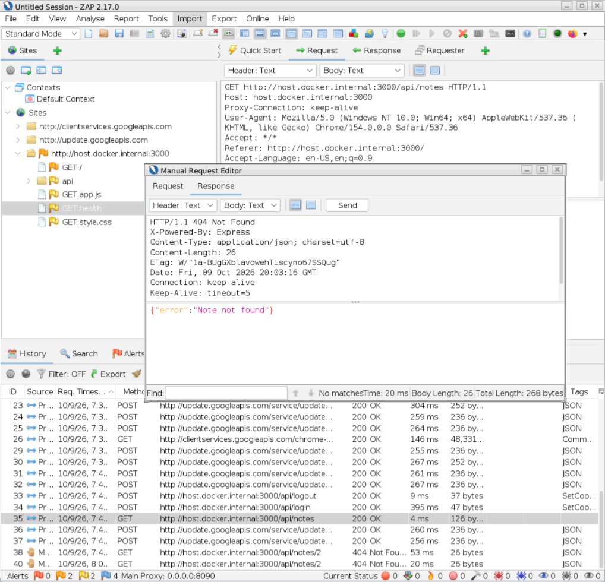

# IDOR Baseline Security Assessment

## Test Information

Application: Secure Notes Lab

Testing Tool: OWASP ZAP

Reference: OWASP WSTG-ATHZ-04

Vulnerability Category: Broken Access Control

## Objective

Verify that an authenticated user cannot access
private notes belonging to another user.

## Test Scenario

Riya owns a private note.

Ram is authenticated using a separate account.

Ram attempts to retrieve Riya's note by modifying
the note identifier in an HTTP GET request.

## Expected Result

The application denies access without exposing
Riya's private note.

## Actual Result

The application returned:

HTTP Status: 404 Not Found

Response Body:
{"error":"Note not found"}

The request was sent using Ram's authenticated session
and referenced a private note owned by Riya.

The server did not disclose Riya's note.

## Conclusion

PASS

The application successfully denied unauthorized
access to another user's private note through
the GET /api/notes/:id endpoint.

The ownership restriction prevented the tested
Insecure Direct Object Reference (IDOR) scenario.

Authorization testing for note modification and deletion
was conducted separately and documented in
idor-put-test.md and idor-delete-test.md.

## Security Control

The API checks both the requested note ID
and the authenticated user's ID before
returning the note.

## Limitations

This test examines one note retrieval endpoint.
Additional testing is needed for updating,
deleting, and other access control scenarios.
