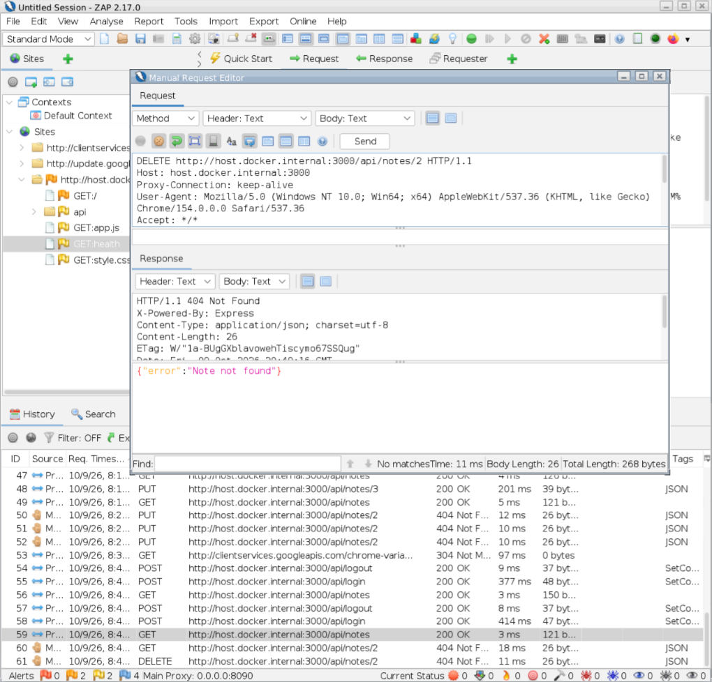

# IDOR Unauthorized Deletion Test

## Test Information

Application: Secure Notes Lab

Testing Tool: OWASP ZAP

Reference: OWASP WSTG-ATHZ-04

Vulnerability Category: Broken Access Control

## Objective

Verify that an authenticated user cannot delete
private notes belonging to another user.

## Test Scenario

Riya owns a private note in Secure Notes Lab.

Ram logged in using a separate account and attempted
to delete Riya's note by modifying an authenticated
HTTP request in OWASP ZAP.

Request Method: DELETE

Endpoint: DELETE /api/notes/:id

## Expected Result

The application denies the unauthorized deletion
request without removing Riya's private note.

Expected HTTP Status: 404 Not Found

Expected Response Body:
{"error":"Note not found"}

## Actual Result

The application returned:

HTTP Status: 404 Not Found

Response Body:
{"error":"Note not found"}

The request was sent using Ram's authenticated session
and targeted a private note belonging to Riya.

The server rejected the unauthorized deletion request.

Note Integrity Verification: Riya's note remained present
and unchanged after Ram's deletion attempt.

## Conclusion

PASS

The application successfully prevented unauthorized
deletion of another user's private note through
the DELETE /api/notes/:id endpoint.

The ownership restriction prevented the tested
Insecure Direct Object Reference (IDOR) scenario.

## Security Control

The DELETE endpoint verifies both the requested
note ID and the authenticated user's ID.

The SQL query uses the following ownership condition:

WHERE id = ? AND owner_id = ?

This prevents an authenticated user from deleting
a note belonging to another account.

## Limitations

This assessment covers one unauthorized deletion
scenario involving two controlled test accounts.

Further testing is required to evaluate additional
authorization scenarios and potential bypasses.
