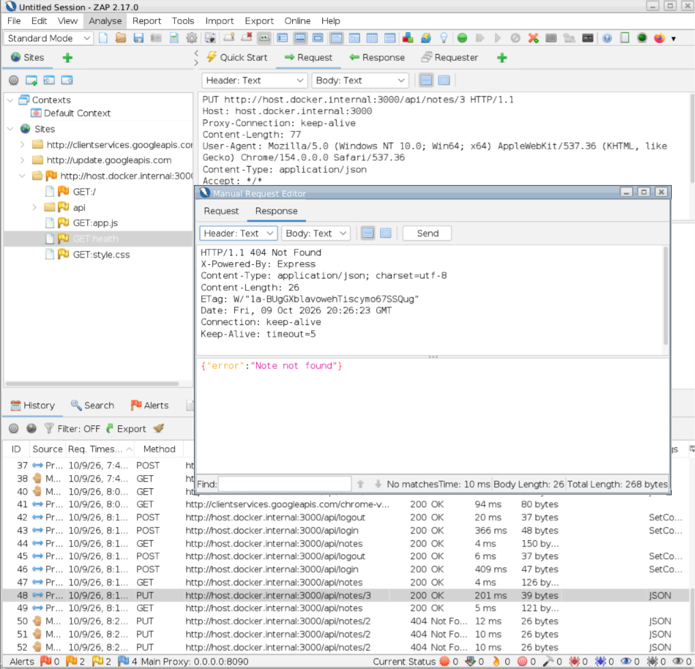

# IDOR Unauthorized Modification Test

## Test Information

Application: Secure Notes Lab

Testing Tool: OWASP ZAP

OWASP Reference: WSTG-ATHZ-04

Vulnerability Category: Broken Access Control

## Objective

Verify that an authenticated user cannot modify
private notes belonging to another user.

## Test Scenario

Ram attempted to modify a private note belonging to Riya
by changing the note ID in an authenticated HTTP PUT request.

## Expected Result

The application denies the unauthorized modification request,
and Riya's note remains unchanged.

## Actual Result

The application returned:

HTTP Status: 404 Not Found

Response Body:
{"error":"Note not found"}

The request was sent using Ram's authenticated session
and targeted a private note belonging to Riya.

The server rejected the unauthorized modification attempt.

Note Integrity Verification: Riya's note remained unchanged
after Ram's unauthorized modification attempt.

## Conclusion

PASS

The application successfully prevented unauthorized
modification of another user's private note through
the PUT /api/notes/:id endpoint.

The ownership restriction prevented the tested
Insecure Direct Object Reference (IDOR) scenario.

## Security Control

The PUT endpoint verifies both the requested
note ID and the authenticated user's ID.

The SQL UPDATE statement uses the following
ownership condition:

WHERE id = ? AND owner_id = ?

This prevents an authenticated user from modifying
a note belonging to another account.

## Limitations

This assessment covers one unauthorized modification
scenario involving two controlled test accounts.

Further testing is required to evaluate additional
authorization scenarios and potential bypasses.