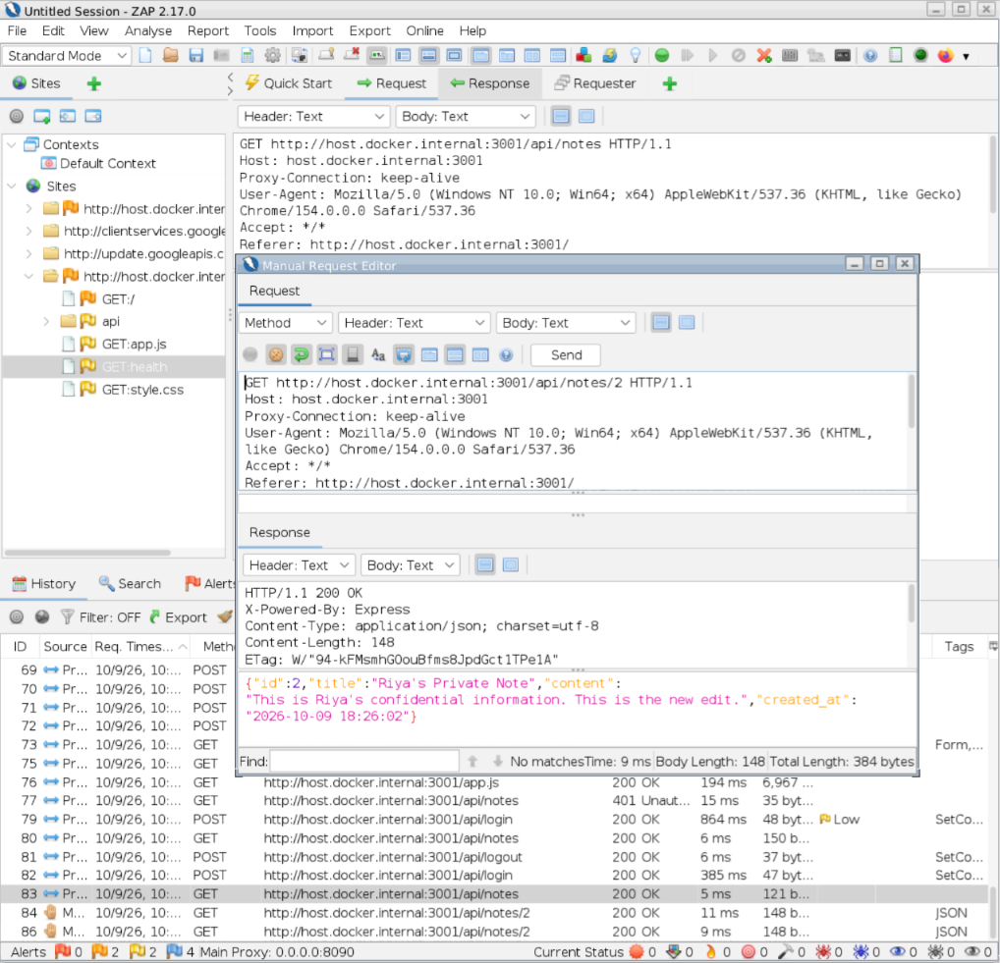

# IDOR Vulnerability Demonstration

## Test Information

Application: Secure Notes Lab (Vulnerable Version)

Testing Tool: OWASP ZAP

Reference: OWASP WSTG-ATHZ-04

Vulnerability Category: Broken Access Control

Environment: Isolated Local Laboratory

Application Port: 3001

## Objective

Demonstrate how missing ownership verification can
allow an authenticated user to access another user's
private information.

## Test Scenario

Riya owns a private note in Secure Notes Lab.

Ram logged in using a separate account and attempted
to retrieve Riya's private note by modifying the note ID
in an authenticated HTTP GET request.

The vulnerable version deliberately omits the ownership
verification from the database query.

Request Method: GET

Endpoint: GET /api/notes/:id

## Vulnerable Implementation

The database query checks only the requested note ID:

```sql
SELECT id, title, content, created_at
FROM notes
WHERE id = ?
```

The query does not verify whether the authenticated user
owns the requested note.

## Expected Result

The vulnerable application returns Riya's private note
even though the request originates from Ram's
authenticated session.

Expected HTTP Status: 200 OK

## Actual Result

The application returned:

HTTP Status: 200 OK

The response contained Riya's private note,
including its title and content.

This confirms that Ram could retrieve a note
belonging to another user.



## Conclusion

VULNERABILITY CONFIRMED

The intentionally vulnerable application allowed
an authenticated user to access another user's
private note without authorization.

The missing ownership verification resulted in
an Insecure Direct Object Reference (IDOR)
vulnerability.

## Security Impact

An authenticated user could access private notes
belonging to other users by supplying their note IDs.

This compromises the confidentiality of user data.

## Comparison with Secure Implementation

Secure Application (Port 3000):
HTTP 404 Not Found

Vulnerable Application (Port 3001):
HTTP 200 OK

The secure implementation checks both the requested
note ID and the authenticated user's ID.

## Limitations

This demonstration was conducted in an isolated
local laboratory using fictional user accounts.

Only the GET endpoint was deliberately made vulnerable.

The experiment does not demonstrate unauthorized
modification or deletion in the vulnerable version.
